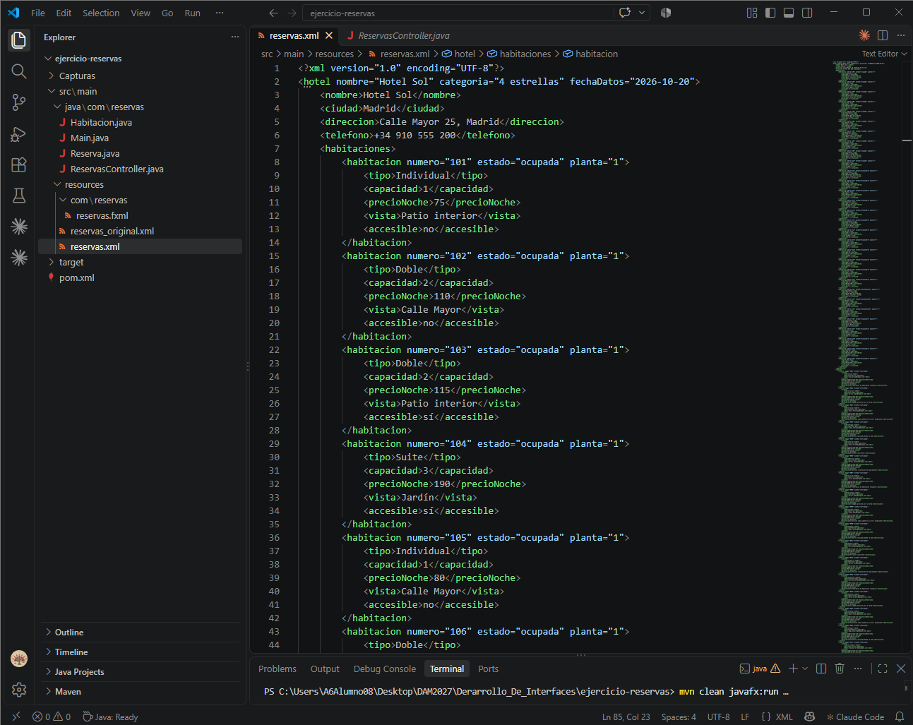
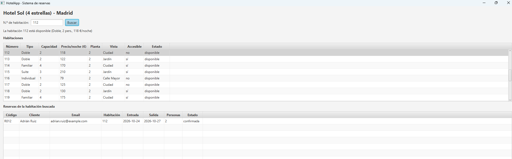
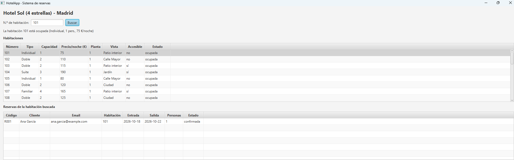
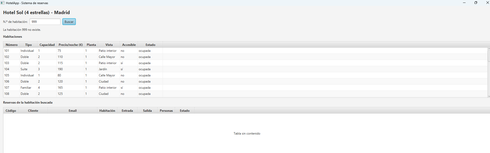
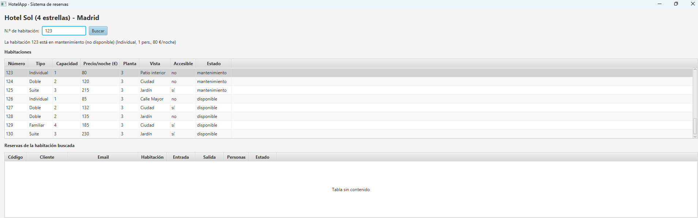

# HotelApp · Sistema de reservas

Aplicación de escritorio en JavaFX que lee los datos de un hotel desde un fichero XML y muestra sus habitaciones y reservas en tablas. Permite buscar una habitación por número para ver su estado (disponible, ocupada o en mantenimiento) y filtrar las reservas que tiene asociadas.

Proyecto de la asignatura **Desarrollo de Interfaces** (DAM). La memoria de la práctica está en [docs/memoria.pdf](docs/memoria.pdf).

## About (English)

HotelApp is a JavaFX desktop app built for an Interface Development course (DAM).
It loads a hotel's rooms and bookings from an XML file and shows them in tables.
Searching by room number shows the room's status (available, occupied or under maintenance) and filters its bookings.
Built with Java 21, JavaFX 21 and Maven.

## Funcionalidades

- Carga del hotel, sus habitaciones y sus reservas desde `reservas.xml` con DOM.
- Tabla de habitaciones: número, tipo, capacidad, precio por noche, estado, planta, vista y accesibilidad.
- Tabla de reservas: código, cliente, email, habitación, fechas de entrada y salida, personas y estado.
- Búsqueda por número de habitación (botón «Buscar» o tecla Enter):
  - selecciona la habitación en la tabla e indica su estado y sus datos;
  - filtra las reservas de esa habitación;
  - avisa si la habitación no existe o si el número no es válido.
- Admite el formato antiguo del XML (`precio_noche`, `habitacion_reservada`) además del actual (`precioNoche`, `habitacionReservada`).

## Tecnologías

- Java 21
- JavaFX 21 (controls y FXML)
- Maven con `javafx-maven-plugin`
- XML (DOM, `javax.xml.parsers`)

## Estructura

```
src/main/java/com/reservas/
├── Main.java                 # Aplicación JavaFX: carga la vista FXML
├── Launcher.java             # Punto de entrada para ejecutar desde el IDE
├── ReservasController.java   # Lectura del XML y lógica de búsqueda
├── Habitacion.java           # Modelo de habitación
└── Reserva.java              # Modelo de reserva
src/main/resources/
├── com/reservas/reservas.fxml   # Interfaz
└── reservas.xml                 # Datos del hotel
docs/
└── memoria.pdf                  # Memoria de la práctica
```

## Instalación

Requisitos: JDK 21 o superior y Maven 3.8 o superior.

```bash
git clone https://github.com/david1cecilia-alt/hotel-reservas-javafx.git
cd hotel-reservas-javafx
mvn compile
```

## Uso

Desde la terminal:

```bash
mvn javafx:run
```

Desde el IDE, ejecuta la clase `com.reservas.Launcher`. Si ejecutas `Main` directamente sin configurar el module-path de JavaFX, Java muestra el error *"JavaFX runtime components are missing"*.

Escribe un número de habitación (por ejemplo `101`) y pulsa **Buscar** o Enter.

## Capturas

| Estructura del proyecto | Habitación disponible |
|---|---|
|  |  |

| Habitación ocupada | Habitación inexistente | En mantenimiento |
|---|---|---|
|  |  |  |

## Autor

David Cecilia · [@david1cecilia-alt](https://github.com/david1cecilia-alt)
